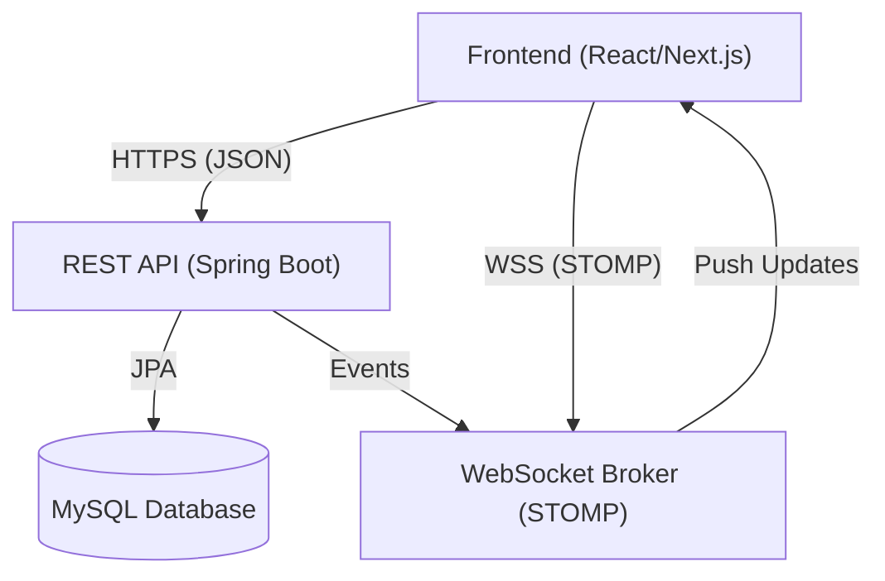
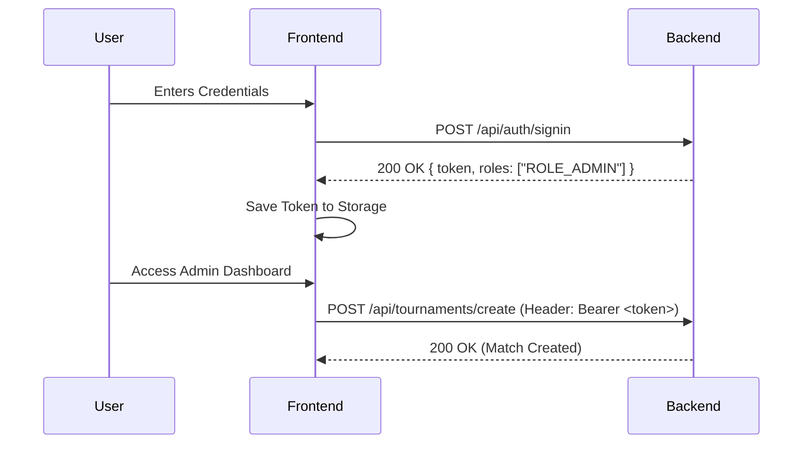
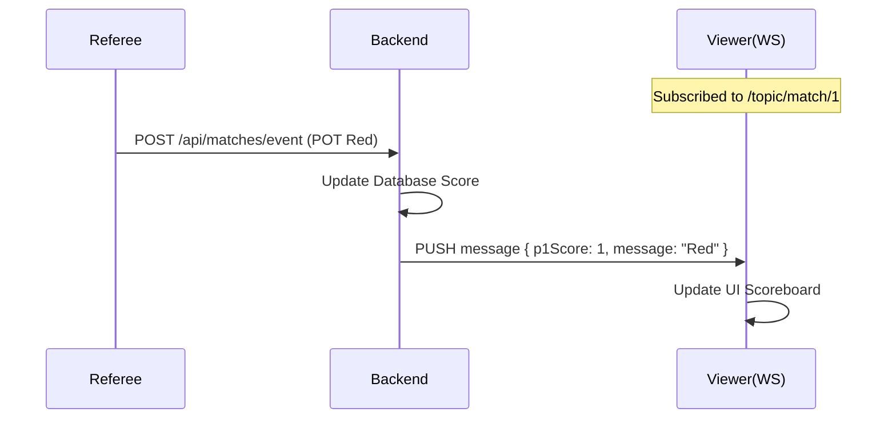

# Frontend Integration Guide

This document assists the Frontend Team in integrating with the Snooker Backend. It details data flows, required endpoints per page, and real-time communication protocols.

## 1. System Architecture

The application follows a standard Client-Server architecture with Real-time capabilities.



---

## 2. Authentication & Security

### Auth Flow

The backend uses **JWT (JSON Web Token)** for security.

1.  **Login**: POST `/api/auth/signin` with `username` & `password`.
2.  **Storage**: Backend returns a `token`. Store this (e.g., `localStorage` or `sessionStorage`).
3.  **Requests**: Attach header `Authorization: Bearer <token>` to **ALL** protected requests.
    - _Public endpoints (Home page) do not require this header._
4.  **Roles**: standard users are `ROLE_USER`. Referees are `ROLE_REFEREE`. Admins are `ROLE_ADMIN`. Use `roles` from the login response to hide/show UI elements.



### Password Reset Flow

1. **Forgot Password**: User enters email → POST `/api/auth/forgot-password` `{ "email": "..." }`
2. **Email Sent**: Backend sends reset link to user's email
3. **Reset Password**: User clicks link with token → POST `/api/auth/reset-password` `{ "token": "...", "newPassword": "..." }`
4. **Success**: User can now login with new password

---

## 3. Page Integration Guide

### A. Public Pages (No Login Required)

#### 1. Home / Landing Page

- **Goal**: Show current "Live" matches and "Upcoming" schedule.
- **Data Required**: List of Matches filtered by status.
- **Endpoints**:
  - `POST /api/matches/filter` payload: `{ "status": "LIVE" }`
  - `POST /api/matches/filter` payload: `{ "status": "SCHEDULED" }`

#### 2. Tournament Viewer

- **Goal**: Show brackets or list of tournaments.
- **Endpoints**:
  - `POST /api/tournaments/all` (Get list)
  - `POST /api/tournaments/all` (Get list)
  - `POST /api/matches/tournament` payload: `{ "id": 1 }` (Get matches for a tournament)

#### 3. Tournament Registration

- **Goal**: Allow users to register for tournaments.
- **Endpoint**: `POST /api/tournaments/{id}/register` with body `{ "id": userId }`
- **Note**: Sends confirmation email to registered user.

#### 4. Newsletter Subscription

- **Goal**: Footer component for email updates.
- **Endpoints**:
  - Subscribe: `POST /api/newsletter/subscribe` `{ "email": "user@example.com" }`
  - Unsubscribe: `POST /api/newsletter/unsubscribe` `{ "email": "user@example.com" }`

---

### B. Admin Dashboard (Role: ADMIN)

#### 1. Tournament Management

- **Actions**: Create, Edit, Delete Tournaments.
- **Endpoints**: `/api/tournaments/create`, `/api/tournaments/update`.

#### 2. Match Scheduling

- **Actions**: Create a match, assign Players and Referee.
- **Endpoints**: `/api/matches/create`
- **Endpoints**: `/api/matches/create`
- **Prerequisite**: Call `/api/players/all` and `/api/tournaments/all` to populate dropdowns.

#### 3. User Management

- **Goal**: Manage user accounts (view, edit, delete).
- **Endpoints**:
  - List all users: `POST /api/users/all`
  - Get user details: `POST /api/users/get` `{ "id": userId }`
  - Update user: `POST /api/users/update` `{ "id": ..., "username": ..., "email": ..., "roles": [...] }`
  - Delete user: `POST /api/users/delete` `{ "id": userId }`
- **Note**: Password updates are optional and automatically encrypted.

---

### C. Referee Console (Role: REFEREE / ADMIN)

- **Goal**: Control the match state and score.
- **Data Flow**: Actions here trigger immediate WebSocket updates for viewers.

| Action          | Endpoint              | Payload                                                              | Note                  |
| :-------------- | :-------------------- | :------------------------------------------------------------------- | :-------------------- |
| **Start Match** | `/api/matches/status` | `{ "matchId": 1, "status": "LIVE" }`                                 | Changes state to Live |
| **Pot Red**     | `/api/matches/event`  | `{ "frameId": 10, "type": "POT", "points": 1, "details": "Red" }`    | Updates score         |
| **Foul**        | `/api/matches/event`  | `{ "frameId": 10, "type": "FOUL", "points": 4, "details": " foul" }` | Points to opponent    |
| **Undo**        | `/api/matches/undo`   | `{ "id": 10 }` (Frame ID)                                            | Reverts last action   |

---

### D. Live Scoreboard (For Public Viewers)

- **Goal**: Display real-time scores without refreshing.
- **Technology**: STOMP over WebSocket.

#### Connection Logic

1.  **Connect**: `http://localhost:8080/ws`
2.  **Subscribe**: `/topic/match/{matchId}`
3.  **Receive**: JSON object `ScoreUpdate`.

#### Payload Example (Incoming WebSocket Message)

```json
{
  "matchId": 1,
  "frameId": 10,
  "p1Score": 14,
  "p2Score": 0,
  "currentBreak": 14,
  "message": "Player 1 potted Red (1 point)"
}
```



---

### E. User Profile Dashboard (Role: USER)

#### Profile Photo Management

- **Upload Photo**:

  - Endpoint: `POST /api/users/{id}/photo`
  - Method: Multipart form data with `file` field
  - Constraints: Max 2MB, JPEG/PNG
  - Example (JavaScript):
    ```javascript
    const formData = new FormData();
    formData.append("file", selectedFile);
    fetch(`/api/users/${userId}/photo`, {
      method: "POST",
      headers: { Authorization: `Bearer ${token}` },
      body: formData,
    });
    ```

- **Display Photo**:
  - Endpoint: `GET /api/users/{id}/photo`
  - Returns: Image binary (JPEG)
  - Example: ``

#### View Registered Tournaments

- Use the tournament registration endpoint to fetch user's tournaments
- Display upcoming matches for registered tournaments
