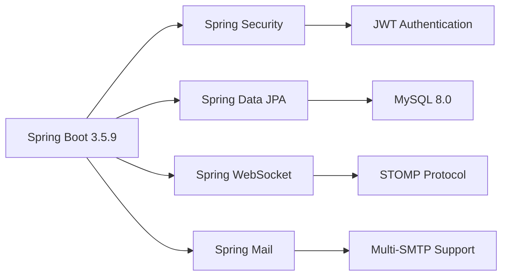
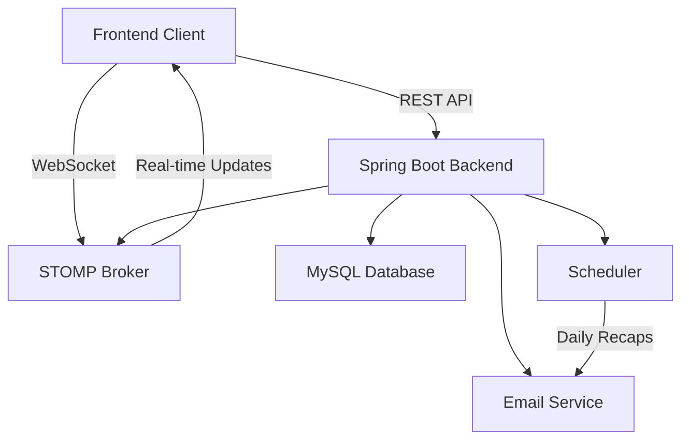

<div align="center">

# 🎱 Snooker Tournament Manager

### _Professional Tournament Management System with Real-Time Scoring_

[](https://openjdk.org/)
[](https://spring.io/projects/spring-boot)
[](https://www.mysql.com/)
[](https://stomp.github.io/)

[Features](#-features) • [Quick Start](#-quick-start) • [API Docs](API_DOCUMENTATION.md) • [Frontend Guide](FRONTEND_INTEGRATION.md)

</div>

---

## 🎯 Overview

A comprehensive, production-ready backend system for managing professional snooker tournaments. Built with Spring Boot, featuring real-time score updates, email notifications, and advanced tournament management capabilities.

## ✨ Features

### 🔐 Authentication & Security

- **JWT-based Authentication** with role-based access control (Admin, Referee, User)
- **Password Reset Flow** with email verification
- **Secure Token Management** with configurable expiration

### 🏆 Tournament Management

- **Full CRUD Operations** for tournaments, matches, and players
- **User Registration** with automated email confirmations
- **Advanced Bracket Structures** for competitive play
- **Custom OBS Overlays** per tournament for broadcasting

### ⚡ Real-Time Features

- **Live Score Updates** via WebSocket (STOMP protocol)
- **Match Event Tracking** (pots, fouls, breaks, safety shots)
- **Undo Functionality** for referees to correct mistakes
- **Instant Notifications** to all connected viewers

### 📧 Email System

- **Multi-Account Support** (Info, Support, Promo)
- **Automated Notifications**:
  - Welcome emails on signup
  - Tournament registration confirmations
  - Match schedule updates
  - Password reset links
  - Daily match recaps (scheduled)
- **Newsletter Management** with subscribe/unsubscribe

### 👤 User Management

- **Profile Photo Upload** (max 2MB, JPEG/PNG)
- **User CRUD Operations** for admins
- **Role Management** (User, Referee, Admin)
- **Search & Filter** capabilities

### 📊 Match Management

- **Comprehensive Scoring System** with frame-by-frame tracking
- **Status Filtering** (Live, Scheduled, Completed)
- **Timeline Events** with full history
- **Referee Controls** for match management

## 🛠️ Tech Stack



**Core Technologies:**

- ☕ **Java 21** - Latest LTS with modern language features
- 🍃 **Spring Boot 3.5.9** - Enterprise-grade framework
- 🔒 **Spring Security** - JWT-based authentication
- 💾 **MySQL 8.0** - Relational database with JPA/Hibernate
- 🔌 **WebSocket (STOMP)** - Real-time bidirectional communication
- 📨 **Spring Mail** - Multi-account email support
- ⏰ **Spring Scheduler** - Automated tasks (daily recaps)

## 🚀 Quick Start

### Prerequisites

- ☕ Java 21 or higher
- 🐬 MySQL Server 8.0+
- 📦 Maven 3.6+

### Installation

1. **Clone the repository**

   ```bash
   git clone <repository-url>
   cd snooker
   ```

2. **Configure Database**

   Update `src/main/resources/application.properties`:

   ```properties
   spring.datasource.url=jdbc:mysql://localhost:3306/snooker
   spring.datasource.username=YOUR_USERNAME
   spring.datasource.password=YOUR_PASSWORD
   ```

3. **Configure Email (Optional)**

   Set up SMTP credentials for email notifications:

   ```properties
   app.mail.info.host=smtp.your-provider.com
   app.mail.info.username=info@yourdomain.com
   app.mail.info.password=YOUR_PASSWORD
   ```

4. **Build & Run**

   ```bash
   mvn clean install
   mvn spring-boot:run
   ```

5. **Access the API**

   Server starts at: `http://localhost:8080`

### First Steps

1. **Create Admin User** - POST to `/api/auth/signup` with role `["admin"]`
2. **Login** - POST to `/api/auth/signin` to get JWT token
3. **Create Tournament** - Use admin token to create your first tournament
4. **Add Players** - Register players for the tournament
5. **Schedule Matches** - Create matches and assign referees

## 📚 Documentation

| Document                                        | Description                                           |
| ----------------------------------------------- | ----------------------------------------------------- |
| [API Documentation](API_DOCUMENTATION.md)       | Complete API reference with request/response examples |
| [Frontend Integration](FRONTEND_INTEGRATION.md) | Guide for frontend developers with WebSocket examples |

## 🏗️ Architecture



## 🔑 Key Endpoints

### Authentication

- `POST /api/auth/signin` - User login
- `POST /api/auth/signup` - User registration
- `POST /api/auth/forgot-password` - Request password reset
- `POST /api/auth/reset-password` - Reset password with token

### Tournaments

- `POST /api/tournaments/all` - List all tournaments
- `POST /api/tournaments/{id}/register` - Register user for tournament

### Matches

- `POST /api/matches/filter` - Filter by status (LIVE, SCHEDULED, COMPLETED)
- `POST /api/matches/event` - Record match event (pot, foul, etc.)
- `POST /api/matches/undo` - Undo last event

### Real-Time

- `WS /ws` - WebSocket connection endpoint
- `SUBSCRIBE /topic/match/{matchId}` - Live score updates

## 🎨 Features Showcase

### Real-Time Scoring

```javascript
// Connect to WebSocket
const socket = new SockJS("http://localhost:8080/ws");
const stompClient = Stomp.over(socket);

// Subscribe to match updates
stompClient.subscribe("/topic/match/1", (message) => {
  const scoreUpdate = JSON.parse(message.body);
  updateScoreboard(scoreUpdate);
});
```

### Email Notifications

- ✅ Welcome emails on signup
- ✅ Tournament registration confirmations
- ✅ Match schedule notifications
- ✅ Schedule change alerts
- ✅ Daily match recaps
- ✅ Password reset links

### Profile Management

- 📸 Upload profile photos (max 2MB)
- 🎫 View registered tournaments
- 🔧 Update account settings

## 🤝 Contributing

Contributions are welcome! Please feel free to submit a Pull Request.

## 📄 License

This project is licensed under the MIT License.

## 🙏 Acknowledgments

Built with ❤️ using Spring Boot and modern Java technologies.

---

<div align="center">

**[⬆ Back to Top](#-snooker-tournament-manager)**

Made with 🎱 by Nisarga

</div>
